# Rocketlane reconstructed technology stack (public, passive evidence)

**Target:** Rocketlane — rocketlane.com, app.rocketlane.com, help.rocketlane.com, developer.rocketlane.com, plus subdomains found through DNS and Certificate Transparency.
**Retrieval date:** 2026-11-01 for every row unless a publication date is also given.
**Method:** public and passive only. There was no login, no trial account, no credential use, and no form input. There was also no port scanning, fuzzing, brute force or load. robots.txt was read first for all hosts. Sources were normal HTTP GETs and response headers, DNS over HTTPS, TLS handshakes, Certificate Transparency, the public Statuspage JSON, public JS bundles, vendor docs, the legal and trust pages, job posts, GitHub, npm, and marketplace and app-store listings. Cookies were recorded by name only. Client keys in public bundles were recorded by variable name only.
**REA:** the pre-login app shell (https://app.rocketlane.com/login) was captured over Chrome DevTools Protocol and analysed with the REA MCP server. `analyze_web_bundle` produced Evidence `ev_9eed7b022647…`: 52 scripts observed and analysed, 50 parsed completely and 2 unavailable. The webpack runtime was detected, source maps returned 403, and the bundles yielded 141 endpoint candidates. `capture_browser_scenario` and `export_web_scripts` produced `ev_5979e158af2b…` and `ev_31743fb1003b…`. All records are in `artefacts/rea-evidence-login.json`. REA never executes the captured JavaScript, and its route and endpoint candidates are static: they don't prove the endpoints are reachable.
**Inputs merged:** `ws1-infra.md` (headers, DNS, TLS, CT, bundles), `ws2-docs.md` (vendor docs, legal, trust), `ws3-secondary.md` (AWS, job posts, GitHub, npm, marketplaces). Raw artefacts are in `artefacts/`.

**Grades**
| Grade | Meaning |
|---|---|
| CONFIRMED | Rocketlane states it: help centre, developer docs, legal or trust pages, or its own careers pages, npm or GitHub org |
| OBSERVED | Seen directly in headers, DNS, TLS, CT, public bundles, REA capture or network requests |
| SECONDARY | Third party: AWS blog interview, job-board copy, press, marketplace or app-store listing, fingerprint site |
| INFERRED | My reasoning, shown in the row |
| UNKNOWN | Not found. Section 5 lists what was searched |

Evidence tokens such as `R036` point to the evidence ledger in section 6.

---

## 1. Findings by layer

### A. Frontend

| Component | Technology | Grade | Evidence | URL | Date |
|---|---|---|---|---|---|
| Q1 Framework (main app) | React 18.3.1 single-page app | OBSERVED + CONFIRMED | Bundle string `version:"18.3.1",rendererPackageName:"react-dom"` R036. Careers pages say "React frontend and Java backend" and "React and modern JavaScript/TypeScript" R172 R173 | https://app.rocketlane.com/app.9b934af5ab213e71.js | 2026-11-01 |
| Q1 Framework (login app) | Separate React 18.3.1 app on id.rocketlane.com | OBSERVED | Same react-dom version string in the id bundle; `<title>Login</title>` R054 | https://id.rocketlane.com/assets/index-n7c4m12N.js | 2026-11-01 |
| Q2 Language | TypeScript (with JavaScript) | CONFIRMED (careers) / INFERRED (bundle) | Careers: "JavaScript/TypeScript" R173. Bundle has tslib helpers `__awaiter` and `__extends` R067 | https://careers.kula.ai/rocketlane/54233-full-stack-engineer | 2026-09-01 |
| Q2 Build tool (main app) | webpack 5 with Module Federation | OBSERVED (REA + bundle) + CONFIRMED (careers) | REA bundle_runtime = webpack, confidence high R203. Chunk global `self.webpackChunkrocket_frontend` R037. Careers: "Knowledge of module bundlers like Webpack" R169 | https://app.rocketlane.com/runtime.b59c055f275236b0.js | 2026-11-01 |
| Q2 Build tool (login app) | Vite | OBSERVED | `<script type="module" …>` and `/vite.svg` R039 | https://id.rocketlane.com/ | 2026-11-01 |
| Q2 Code splitting | Hashed and named chunks: `common-0` to `common-44`, plus `antd`, `lodash`, `bryntum-gantt`, `sheets`, `customer-portal`, `cke` and others | OBSERVED (REA) | REA export lists 54 script URLs from the login page, including `antd.4cd505387b91c671.js` R214. The runtime has about 300 chunk names | https://app.rocketlane.com/login | 2026-11-01 |
| Q2 Source maps | Referenced but not public (HTTP 403 from S3) | OBSERVED (REA + curl) | REA: "Source-map server returned HTTP 403." R204. curl HEAD returned 403 R040 | https://app.rocketlane.com/app.9b934af5ab213e71.js.map | 2026-11-01 |
| Q3 State management | Redux with redux-saga; TanStack React Query 4.36.1 | OBSERVED | redux-saga error string R043; runtime share scope `@tanstack/react-query` 4.36.1 R041 | https://app.rocketlane.com/runtime.b59c055f275236b0.js | 2026-11-01 |
| Q3 UI component library | Ant Design, styled-components 6.5.3, Radix primitives | OBSERVED (REA + bundle) | REA script list has the `antd` chunk R214; `styled-components` 6.5.3 R042; `Symbol.for("radix-ui")` found by bundle grep | https://app.rocketlane.com/runtime.b59c055f275236b0.js | 2026-11-01 |
| Q3 Design system | Internal design system, probably named "Ozone" | INFERRED | `ozone-select` component class in the sheets chunk, plus CT host `ozone.rocketlane.com`. Design-system docs run on Next.js on Vercel R063 | https://ui-docs.rocketlane.com/ | 2026-11-01 |
| Q4 Rich-text / document editor | CKEditor 5 with CKEditor Cloud Services real-time collaboration | OBSERVED (bundle + REA) | `RealTimeCollaborativeEditing` R044; `cke-cs.com` R045; REA endpoint candidate `ContextualBalloon` (a CKEditor 5 class) R213 | https://app.rocketlane.com/cke.e8eb7b03871e61dd.js | 2026-11-01 |
| Q4 Gantt / timeline | Bryntum Gantt and Scheduler Pro (commercial) | OBSERVED | Chunk `bryntum-gantt` R046; `bryntum.com` appears 35 times in the chunk; REA evidence has 70 `bryntum` matches | https://app.rocketlane.com/bryntum-gantt.f470147093f5d80c.js | 2026-11-01 |
| Q4 Grid | AG Grid Enterprise (licensed) | OBSERVED | `Please_report_misuse_to_legal@ag-grid.com` R047; chunks `ag-grid-community` and `ag-grid-enterprise` | https://app.rocketlane.com/app.9b934af5ab213e71.js | 2026-11-01 |
| Q4 Spreadsheet engine (Sheets) | In-house sheet module, probably on AG Grid Enterprise; has a versioned v2 | INFERRED + OBSERVED (REA endpoints) | Sheets chunk has `updateSheetPivot` and `createdFormulas`; no hits for handsontable, univer, SpreadJS, HyperFormula or luckysheet R066. REA endpoint candidates `/sheets/enable-v2` and `/sheets/enable-versioning` R205. CT names `api.sheets.eu`, `sheets` | https://app.rocketlane.com/sheets.0a06dae913dd59d6.js | 2026-11-01 |
| Q4 PDF and charts | PDFTron/Apryse WebViewer, pdf.js, react-pdf, KendoReact PDF export, Highcharts | OBSERVED | `@progress/kendo-react-pdf` R048; env var name `REACT_APP_PDFTRON_KEY`; chunks `pdfjs-dist` and `highcharts` | https://app.rocketlane.com/runtime.b59c055f275236b0.js | 2026-11-01 |
| Q5 Real-time (app) | Pusher Channels (pusher-js with SockJS fallback), authorised by the backend `/pusher/*` | OBSERVED + CONFIRMED | `this.post("/pusher/heartbeat",e)` R049, with 74 `pusher` hits in app.js on direct fetch. Sub-processor: "Enables real-time messaging and notifications for platform updates." R121 | https://app.rocketlane.com/app.9b934af5ab213e71.js | 2026-11-01 |
| Q5 Real-time (documents) | CKEditor Cloud Services collaboration (socket.io inside the CKEditor client) | OBSERVED | `this._socket.io.off("reconnect_error")` in the cke chunk; `cke-cs.com` R045. A 2025 status incident on Spaces names "our vendor" R025 | https://app.rocketlane.com/cke.e8eb7b03871e61dd.js | 2026-11-01 |
| Q5 CRDT/OT library | No standalone CRDT or OT library found | UNKNOWN | No hits for yjs, y-websocket, automerge, sharedb, `EventSource` or `new WebSocket` outside CKEditor and Pusher | — | 2026-11-01 |
| Q6 Micro-frontends | Webpack Module Federation remotes: `signals` (exposes `./NitroPages`, served from scarlet-mod) and `agents` | OBSERVED | `entry:"https://scarlet-mod.rocketlane.com/remoteEntry.js"` R038; `https://agents.rocketlane.com/remoteEntry.js` | https://app.rocketlane.com/runtime.b59c055f275236b0.js | 2026-11-01 |
| Q6 Customer portal | Same SPA (lazy `customer-portal` chunk). Customer custom domains serve the same S3 object | OBSERVED + OBSERVED (REA) | Identical `X-Amz-Version-Id` on supportlogic.rocketlane.com and app R061. REA endpoint candidate `/customer-portal-theme` R217 | https://supportlogic.rocketlane.com/ | 2026-11-01 |
| Q6 Tenant routing in the browser | Per-company subdomain; API host derived from the page host | OBSERVED | boot.js `t.replace(i,o+"//"+i+".api")` R059 | https://app.rocketlane.com/js/boot.779d16b6f62a7bd174c24073856791c96c908164.js | 2026-11-01 |
| Q7 Mobile | Native-store apps exist: iOS `com.rocketlane.rocketApp` v0.7.1, Android `com.rocketlane.app` | OBSERVED (existence) + SECONDARY (listing) | iTunes Search bundle id R065; publisher ROCKETLANE TECHNOLOGIES PRIVATE LIMITED R189 | https://apps.apple.com/us/app/rocketlane/id6450273789 | 2026-11-01 |
| Q7 Mobile framework | Native, React Native or Flutter | UNKNOWN | No framework string on either store listing; binaries not downloaded (out of passive scope) | — | 2026-11-01 |
| Q8 Error monitoring / RUM | Datadog RUM | OBSERVED + CONFIRMED | `REACT_APP_DATADOG_SITE:"datadoghq.com"` R050, also found once in runtime.js on direct fetch; cookie `_dd_s_v2`. Sub-processor Datadog R122 | https://app.rocketlane.com/runtime.b59c055f275236b0.js | 2026-11-01 |
| Q8 Session replay | LogRocket (disabled on the login page) | OBSERVED + CONFIRMED | "LogRocket is disabled on localhost, login page, or restricted env" R051. Sub-processor LogRocket R123 | https://app.rocketlane.com/app.9b934af5ab213e71.js | 2026-11-01 |
| Q8 Product analytics | Mixpanel (sub-processor), but no Mixpanel SDK in the scanned app bundles | CONFIRMED (vendor) / conflict with OBSERVED absence | Sub-processor: "Used to collect and analyze product usage analytics." R124. Zero bundle hits; Mixpanel appears only in the Okta login CSP. It may load server-side or only after login | https://www.rocketlane.com/legal/sub-processors | 2026-11-01 |
| Q8 Product analytics (third party) | Hotjar | SECONDARY | BuiltWith free tier, read through a WebFetch summary, not verbatim R202 | https://builtwith.com/app.rocketlane.com | 2026-11-01 |
| Q8 Feature flags | In-house flags (no third-party flag SDK) | INFERRED | Constants `COGNITO_ENABLED` R053 and `partnerRbacEnabled`; zero hits for LaunchDarkly, Split, Statsig, GrowthBook or PostHog. REA endpoint candidate `/meetings/ai-fills/feature-flag` R208 | https://app.rocketlane.com/app.9b934af5ab213e71.js | 2026-11-01 |
| Q8 In-app support / announcements | Intercom, Beamer, Freshdesk | OBSERVED | Env var name `REACT_APP_INTERCOM_APP_ID`; `app.getbeamer.com/js/beamer-embed.js`; `rocketlanecorp.freshdesk.com` (bundle grep) | https://app.rocketlane.com/app.9b934af5ab213e71.js | 2026-11-01 |

### B. Backend

| Component | Technology | Grade | Evidence | URL | Date |
|---|---|---|---|---|---|
| Q9 Core backend language/framework | Java with Spring / Spring Boot | CONFIRMED (careers) + OBSERVED (servlet) | "Familiarity with Java/Spring Boot stacks (our backend)" R174; "Spring, PostgreSQL, Redis, Docker, message brokers, and GitHub" R170; api.rocketlane.com returns `JSESSIONID` R008 | https://careers.kula.ai/rocketlane/54840-product-security-engineer | 2026-09-16 |
| Q9 AI/LLM services language | Python | CONFIRMED | "Python (our AI/LLM stack)" R174 | https://careers.kula.ai/rocketlane/54840-product-security-engineer | 2026-09-16 |
| Q9 MCP server runtime | Python ASGI on uvicorn (mcp and mcp.eu hosts) | OBSERVED | `server: uvicorn` R009 R010 | https://mcp.rocketlane.com/ | 2026-11-01 |
| Q9 Email service | Node.js Express on AWS App Runner behind Envoy | OBSERVED | `x-powered-by: Express` R011; CNAME `…us-east-1.awsapprunner.com.` R012 | https://emails.rocketlane.com/ | 2026-11-01 |
| Q10 Architecture style | Service-oriented: a Java core API with separate satellite services. Separate hosts: admin API, conversation-service, marketplace API, sheets API, MCP, agents, emails, Teams bot, migration, rocket-vector | OBSERVED (hosts) / INFERRED (style) | `https://conversation-service.rl-platforms.rocketlane.com` R057; `admin.api…/api/v1/accounts/domain` R058; CT `mcp.eu…` R033 and `rocket-vector.rl-platforms-eu…` R034. The CTO is "passionate about service oriented architectures (SOA)" R165 | https://app.rocketlane.com/app.9b934af5ab213e71.js | 2026-11-01 |
| Q10 Status-page components | Only two components: Backend and Rocketlane Web Application. Statuspage does not show service boundaries | OBSERVED | components.json `Backend` R022 and `Rocketlane Web Application` R023. The app embeds a Statuspage frame R215 | https://status.rocketlane.com/api/v2/components.json | 2026-11-01 |
| Q10 Internal API surface (REA) | Feature-scoped REST paths: sheets, agents, ai-agents, automations, connection-store, meetings, integration-providers, marketplace, customer-portal-theme, web-forms, translations | OBSERVED (REA, static candidates) | 141 unique endpoint candidates in ev:9eed7b022647, e.g. R205 R206 R207 R209 R210 R211 R212 | https://app.rocketlane.com/login | 2026-11-01 |
| Q11 Public API style and versioning | REST with some RPC-style action endpoints; JSON; version in the path `/api/1.0`; OpenAPI 3.0.1 | CONFIRMED + OBSERVED | "The API follows RESTful principles…" R069; "some API calls follow an RPC-like structure" R070; the spec's `servers` block exposes Staging `https://api.nitro.run/api` R075 and Orbits `https://project.api.orbits.run/api` R076 | https://developer.rocketlane.com/docs/overview.md | 2026-11-01 |
| Q11 Public API auth | Static API key in the `api-key` header | CONFIRMED | "has a valid api-key that you acquired from the Rocketlane API Settings tab" R077 | https://developer.rocketlane.com/reference/get-task.md | 2026-11-01 |
| Q11 Internal API (web app) | REST on `/api/v1` (a different prefix from the public `/api/1.0`) | OBSERVED (REA capture) | Pre-login GETs `/api/v1/accounts/get-meta`, `/api/v1/home/init`, `/api/v1/users/profile` R060; `/home/init` appears 3 times in app.js on direct fetch | https://api.rocketlane.com/api/v1/home/init | 2026-11-01 |
| Q11 Pagination, IDs, errors, tracing | Token pagination (`pageSize` max 100, `pageToken` valid 15 min); `int64` IDs; event IDs are UUIDs; errors `{errors:[{errorCode,errorMessage}]}`; `X-Request-Id` header | CONFIRMED / OBSERVED | R073 R079 R078 R071 | https://developer.rocketlane.com/docs/pagination.md | 2026-11-01 |
| Q11 Rate limits | 100 requests/min per user per endpoint, 60-second rolling window; search APIs 60/min. Rate-limit headers not documented | CONFIRMED | R101 R102 | https://help.rocketlane.com/support/solutions/articles/67000755761-why-am-i-getting-a-rate-limit-error-during-bulk-updates- | 2026-11-01 |
| Q11 GraphQL / gRPC | None observed | UNKNOWN (not observed) | No `graphql` string in the REA-exported scripts or the docs | — | 2026-11-01 |
| Q12 Background jobs / queue | Redis (Amazon ElastiCache) used to queue background jobs; "message brokers" named without a product | SECONDARY + CONFIRMED (generic) | CTO: "we use AWS Elasticache for reliable queue time-sensitive background jobs" R164; backend posting lists "message brokers" R170 | https://aws.amazon.com/blogs/apn/rocketlane-partners-with-aws-saas-factory-and-aws-marketplace-to-power-its-customer-onboarding-platform-with-saas | 2023-05-30 |
| Q12 Automation engine | Trigger → condition → action rules, metered per run per user per month; stops at the limit; per-action logs. Engine technology not named | CONFIRMED (behaviour) / UNKNOWN (tech) | R110 R108 R109; REA endpoint candidates `/automation-logs` R209 and `/automation-templates/saved-automations` | https://help.rocketlane.com/support/solutions/articles/67000722958-introduction-to-automations | 2026-11-01 |
| Q13 Webhook trigger model | An automation action ("Send webhook"); task triggers only | CONFIRMED | "Currently, we only support task triggers for webhooks." R081 | https://developer.rocketlane.com/docs/setting-up-webhooks-in-rocketlane.md | 2026-11-01 |
| Q13 Webhook auth / signing | HTTPS only; optional Basic Auth on the receiver; no HMAC signing documented | CONFIRMED / UNKNOWN (signing) | R080 R085 | https://developer.rocketlane.com/docs/setting-up-webhooks-in-rocketlane.md | 2026-11-01 |
| Q13 Webhook delivery | Success = 200/204; 10 s timeout; ordering not guaranteed; claims exactly one delivery per event; retry policy not documented | CONFIRMED / UNKNOWN (retries) | R082 R083 R084; launched Feb 26 2024 as "Task webhooks" R152 | https://developer.rocketlane.com/docs/webhook-delivery.md | 2026-11-01 |
| Q14 Search | Global search over tasks, projects, chats, files and spaces. The index updates asynchronously (seconds of lag). Engine not named | CONFIRMED (feature) / INFERRED (async index) / UNKNOWN (engine) | R111 R074 | https://help.rocketlane.com/support/solutions/articles/67000753390-using-global-search-in-rocketlane | 2026-11-01 |
| Q15 File storage | Stored in AWS and encrypted at rest; S3 implied; users can't permanently delete files; CKEditor uploads go to `/attachments/cke-upl…` | CONFIRMED (AWS) / INFERRED (S3) / UNKNOWN (limits) | R145 R112; `uploadAttachmentInCKEditor` (bundle grep) | https://help.rocketlane.com/support/solutions/articles/67000737703-can-documents-and-files-sent-in-all-files-and-conversations-be-deleted- | 2026-11-01 |

### C. Data

| Component | Technology | Grade | Evidence | URL | Date |
|---|---|---|---|---|---|
| Q16 Primary database | PostgreSQL on Amazon RDS | SECONDARY (CTO) + CONFIRMED (careers) | "Amazon RDS for managed relational database" R160; "Spring, PostgreSQL, Redis…" R170; GitHub fork "GitHub Action to setup a PostgreSQL database" R192. The vendor security PDF says only "all databases" R144 | https://careers.kula.ai/rocketlane/12592-lead-software-enginner-backend | 2025-08-26 |
| Q17 Multi-tenancy | Pooled multi-tenant SaaS with logical isolation; per-company subdomains | CONFIRMED + OBSERVED | "pure multi-tenant SaaS application" R143; "multi-tenant architecture that can scale horizontally at every layer" R167; "tenant isolation is a first-order concern" R181; subdomain-to-API-host routing R059 | https://cdn.prod.website-files.com/6360d3edc696260ba2aecbc7/64d0c65700a997dccc386c70_Security%20and%20compliance%20at%20Rocketlane.pdf | 2026-11-01 |
| Q17 Tenancy model detail | Shared schema with a tenant ID is likely; schema-per-tenant or DB-per-tenant not ruled out | INFERRED / UNKNOWN | Inferred from "pure multi-tenant" plus AWS SaaS Factory involvement ("helping us to get to market faster…" R159). No SaaS Factory reference architecture naming Rocketlane was found | — | 2026-11-01 |
| Q18 Cache | Redis on ElastiCache | SECONDARY + CONFIRMED | R164 R170 | https://careers.kula.ai/rocketlane/12592-lead-software-enginner-backend | 2025-08-26 |
| Q18 Analytics / reporting store | ClickHouse ("Product analytics, dashboards, and reporting") | CONFIRMED | R127 | https://www.rocketlane.com/legal/sub-processors | 2026-11-01 |
| Q18 Product analytics / ETL / warehouse | Mixpanel for product usage. No internal warehouse or ETL named | CONFIRMED / UNKNOWN | R124 | https://www.rocketlane.com/legal/sub-processors | 2026-11-01 |
| Q19 Data residency | Two data centres: US DC and EU DC (AWS Germany). Separate EU hosts observed (api.eu, mcp.eu, api.sheets.eu, agents-eu, rocket-vector EU) | CONFIRMED + OBSERVED | "European union Data Centre" R133; AWS EU location Germany R119; separate EU API certificate R032; EU MCP R010 | https://www.rocketlane.com/legal/sub-processors | 2026-11-01 |
| Q19 EU coverage gaps | Okta, LogRocket, Mixpanel and Scalekit are listed only under the US DC | CONFIRMED (absence on list) | Sub-processor tables (ws2 §2) | https://www.rocketlane.com/legal/sub-processors | 2026-11-01 |
| Q19 Backup and retention | Daily backups, last 7 kept, yearly DR simulation (2023-era PDF); account can be reinstated within 30 days of termination | CONFIRMED | R144 R138 | https://www.rocketlane.com/legal/terms | 2026-11-01 |

### D. AI (Nitro)

| Component | Technology | Grade | Evidence | URL | Date |
|---|---|---|---|---|---|
| Q20 LLM providers | OpenAI, Anthropic, Google | CONFIRMED | "AI model services used by Nitro's AI features (as applicable)." R128 | https://www.rocketlane.com/legal/sub-processors | 2026-11-01 |
| Q20 Primary model family | Claude (Anthropic) | CONFIRMED (careers) + OBSERVED (DNS) | "building Nitro, our AI-native product layer on Claude and MCP" R178; two `anthropic-domain-verification` TXT records R029 | https://careers.kula.ai/rocketlane/54908-lead-product-security-engineer | 2026-09-17 |
| Q21 Direct API vs cloud AI service | Direct vendor APIs with EU residency options (OpenAI "Narvik, Norway", Anthropic "EU Specific Workspace", Google "Germany") | INFERRED | The vendors are listed as sub-processors themselves, not as AWS Bedrock, Azure or Vertex R134 R135 | https://www.rocketlane.com/legal/sub-processors | 2026-11-01 |
| Q21 Bedrock / Vertex | Not found. Conflicting signal: AWS is the host, but no Bedrock mention anywhere | UNKNOWN | Careers name Claude, not the channel; AWS blog (2023) predates Nitro | — | 2026-11-01 |
| Q21 AI gateway | Bifrost AI gateway (Go) forked by Rocketlane on 2026-09-19, pushed 2026-10-26. Production use not stated | OBSERVED (fork) / INFERRED (use) | "Fastest enterprise AI gateway" R195 | https://github.com/Rocketlane | 2026-10-26 |
| Q22 Meeting capture | Own-brand "Rocketlane AI Notetaker" bot for Zoom, Teams and Meet, plus bot-less cloud retrieval from Gong, Zoom, Teams (Microsoft Graph) and Google Meet | CONFIRMED + OBSERVED (REA) | R098 R099 R100; REA endpoint candidates `/integration-providers/gong/meta` and the zoom, microsoft_teams and meet_cloud_recording equivalents R211; `/meetings/ai-fills/feature-flag` R208 | https://help.rocketlane.com/support/solutions/articles/67000739897-enabling-meeting-intelligence-in-rocketlane-for-admins- | 2026-11-01 |
| Q22 Notetaker bot vendor / transcription engine | Not named; no Recall.ai, Deepgram, AssemblyAI or Whisper on the sub-processor list | UNKNOWN | See section 5 | — | 2026-11-01 |
| Q23 Vector store / RAG | Weaviate; a `rocket-vector` service host in the EU platform zone | CONFIRMED + OBSERVED | "Vector database to store meetings, emails, pages, and signals for use by AI agents." R130; CT `rocket-vector.rl-platforms-eu.rocketlane.com` R034 | https://www.rocketlane.com/legal/sub-processors | 2026-11-01 |
| Q23 Agent framework / tracing | LangSmith tracing, so LangChain/LangGraph is likely | CONFIRMED (LangSmith) / INFERRED (LangChain) | R131 R156 | https://www.rocketlane.com/legal/sub-processors | 2026-11-01 |
| Q23 Agent execution | E2B sandbox containers; code execution in agent tooling | CONFIRMED | R132; "unsafe code execution in agent tooling" R179 | https://www.rocketlane.com/legal/sub-processors | 2026-11-01 |
| Q23 Agent surfaces in app | `agents` Module Federation remote; endpoint families `/agents/workforce_agents`, `/agents/migration_agents`, `/ai-agents/lite` | OBSERVED (REA + bundle) | R206 R207; agents remoteEntry (W38 context) | https://app.rocketlane.com/login | 2026-11-01 |
| Q23 Interaction pipeline | Meetings and emails are normalised into a "common transcript object", feeding AI pages and Signals | CONFIRMED | R103 | https://help.rocketlane.com/support/solutions/articles/67000753317-rocketlane-ai-for-interaction-data-mental-model-and-behavior | 2026-11-01 |
| Q24 AI credit metering | Credits are charged per agent run, "based on the work performed"; a run is not one AI call | CONFIRMED | R104 R105 | https://help.rocketlane.com/support/solutions/articles/67000755370-nitro-credit-consumption | 2026-11-01 |
| Q24 Training / retention / guardrails | No training on customer data (Terms). Zero-data-retention with LLM vendors not stated. Eval or guardrail tooling not named | CONFIRMED / UNKNOWN | R137 | https://www.rocketlane.com/legal/terms | 2026-11-01 |
| Q25 MCP server | `https://rocket-mcp.rl-platforms.rocketlane.com/mcp`, streamable HTTP; OAuth (Rocketlane sign-in, then email OTP, then org pick); 24 tools (12 read, 12 write), no deletes | CONFIRMED | R094 R093 R095 R096 R097 | https://help.rocketlane.com/support/solutions/articles/67000754219-connect-rocketlane-mcp-to-claude-code | 2026-11-01 |
| Q25 MCP auth provider | Scalekit (OAuth 2.0 for MCP) | CONFIRMED | R129 | https://www.rocketlane.com/legal/sub-processors | 2026-11-01 |
| Q25 MCP runtime and regions | Python/uvicorn on `mcp` and `mcp.eu` hosts. The documented URL host differs (`rocket-mcp.rl-platforms`) | OBSERVED | R009 R010 | https://mcp.eu.rocketlane.com/ | 2026-11-01 |

### E. Infrastructure and operations

| Component | Technology | Grade | Evidence | URL | Date |
|---|---|---|---|---|---|
| Q26 Cloud provider | AWS for all applications | CONFIRMED (sub-processors, careers) + SECONDARY (APN) | "Primary cloud infrastructure provider for Rocketlane, where all our applications are hosted." R119; "Review and harden our AWS setup" R175; APN R157; Marketplace "Deployed on AWS" R186 | https://www.rocketlane.com/legal/sub-processors | 2026-11-01 |
| Q26 Regions | US (us-east-1 IP range) and EU (eu-central-1 IP range, "Germany") | CONFIRMED (US/Germany) / INFERRED (exact regions) | R068 R155; App Runner hostname `us-east-1` R012 | https://api.eu.rocketlane.com/ | 2026-11-01 |
| Q26 CDN | CloudFront for the app, id, agents, assets-cdn and status sites; static SPA on S3 | OBSERVED | `Server: AmazonS3` R005; `X-Amz-Cf-Pop: HYD57-P4` R006; apex redirect `LambdaGeneratedResponse from cloudfront` R017 | https://app.rocketlane.com/ | 2026-11-01 |
| Q26 CDN (third-party sites) | Cloudflare in front of Webflow (marketing), Freshdesk (help) and ReadMe (developer) | OBSERVED | `Server: cloudflare` R016; Webflow `x-wf-region` R015; Freshdesk CNAME R018; ReadMe CNAME R020 | https://www.rocketlane.com/ | 2026-11-01 |
| Q26 WAF / load balancing | AWS WAF, ALB, CloudFront, Global Accelerator | SECONDARY (CTO) + CONFIRMED (careers) / not OBSERVED in headers | "Application Load Balancer" R162; "ALB/CloudFront TLS policies and cipher suites" R177. No WAF header seen on normal GETs | https://careers.kula.ai/rocketlane/54840-product-security-engineer | 2026-09-16 |
| Q26 DNS provider | AWS Route 53 (wildcard `*.rocketlane.com` to CloudFront) | OBSERVED | NS `ns-167.awsdns-20.com.` R026; wildcard answer R030 | https://dns.google/resolve?name=rocketlane.com&type=NS | 2026-11-01 |
| Q26 TLS | ACM certificates (Amazon RSA 2048 M01); a separate certificate per API region | OBSERVED | R031 R032 | https://app.rocketlane.com/ | 2026-11-01 |
| Q26 Email | Google Workspace mail; SES inbound; SendGrid (product mail) and HubSpot (marketing) outbound | OBSERVED + CONFIRMED | SPF includes R027; SES MX R028; SendGrid sub-processor R120 | https://dns.google/resolve?name=rocketlane.com&type=TXT | 2026-11-01 |
| Q27 Containers / orchestration | Amazon ECS for core services; AWS App Runner for the email service; CloudFront edge function for the apex redirect | SECONDARY + CONFIRMED (ECS) / OBSERVED (App Runner) | "for managed container orchestration" R161; "container security on ECS or similar" R176; App Runner CNAME R012 | https://careers.kula.ai/rocketlane/54840-product-security-engineer | 2026-09-16 |
| Q27 IaC | One of Terraform, Ansible, Chef or CloudFormation; which one is not stated | UNKNOWN | The posting lists all four R184; no public IaC repos | https://careers.kula.ai/rocketlane/9833-senior-software-engineer-systems | 2025-07-10 |
| Q28 Observability | Datadog (APM, alerting, central logs, RUM), LogRocket, LangSmith; Prometheus and Grafana in DevOps postings; internal "observability platform" | CONFIRMED + OBSERVED | R122 R050 R123 R131 R185 R171 | https://www.rocketlane.com/legal/sub-processors | 2026-11-01 |
| Q29 CI/CD | GitHub Actions on self-hosted EC2 runners; JaCoCo coverage on PRs; release-please; Dependabot; protected branches; canary rollout to internal accounts; rolling deploys | OBSERVED + CONFIRMED | R191 R193 R194 R183 R148 R149 | https://github.com/Rocketlane | 2026-11-01 |
| Q29 Release cadence | About 2.5 public changelog posts a month (30 posts Nov 2025–Oct 2026); bundles stamped with a git-SHA build ID; S3 object versioning | OBSERVED | R154; `REACT_APP_BUILD_ID` matches the boot.js file name (bundle grep) | https://app.getbeamer.com/rocketlaneapp/en | 2026-11-01 |

### F. Security and identity

| Component | Technology | Grade | Evidence | URL | Date |
|---|---|---|---|---|---|
| Q30 Identity provider (live today) | Okta custom domain `login.rocketlane.com` | OBSERVED | CNAME `rocketlane.customdomains.okta.com.` R013; `x-okta-request-id` R014; Okta still on the sub-processor list R125 | https://login.rocketlane.com/ | 2026-11-01 |
| Q30 Identity provider (migration) | Moving the internal auth layer from Okta to AWS Cognito; customer IdPs unaffected; 30–60 min downtime per tenant | CONFIRMED + OBSERVED (code path) | "Rocketlane is migrating its internal authentication infrastructure from Okta to AWS Cognito." R087; "This change affects only the login layer." R088; code enum with COGNITO and OKTA R052; flag `COGNITO_ENABLED` R053, also found once on direct fetch | https://help.rocketlane.com/support/solutions/articles/67000755973-updating-sso-for-rocketlane-s-authentication-migration | 2026-11-01 |
| Q30 Conflict: Okta vs Cognito | The help article says the migration is in progress. The live login host is still Okta, and the Cognito path is behind a feature flag | OBSERVED (conflict, consistent with a phased rollout) | R087 vs R013 R053 | — | 2026-11-01 |
| Q30 New login front end | id.rocketlane.com (Vite + React) calls an auth broker at `id.nitro.run` | OBSERVED | `https://id.nitro.run/api/v1/authenticate?` R054; CT `id.nitro.run` R035 | https://id.rocketlane.com/assets/index-n7c4m12N.js | 2026-11-01 |
| Q30 SSO / SCIM / MFA / magic links | SAML SSO (Okta, Google, Azure guides); IdP-initiated login arrives with Cognito; Okta and Azure SCIM; TOTP 2FA; single-use magic links valid 7 days, JWT-secured | CONFIRMED + OBSERVED | R106 R089 R107 R092 R091 R150; code `MAGIC_LINK_AUTHENTICATION` R055, SCIM key R056 | https://help.rocketlane.com/support/solutions/articles/67000745544-2fa-and-magic-links | 2026-11-01 |
| Q31 Certifications | SOC 2 (Type II per PDF), ISO 27001, ISO 27701, ISO 42001, HIPAA, GDPR, CSA STAR, CPRA, CASA, Cyber Essentials Plus; annual third-party pen test; Sprinto-style GRC tooling | CONFIRMED | "ISO 42001 Certified" R139; "HIPAA Compliant" R140; pen test R151; Sprinto R180 | https://www.rocketlane.com/trust | 2026-11-01 |
| Q32 Encryption | At rest in AWS (S3 objects `AES256` SSE observed); TLS 1.2 for the API; HSTS preload on the app; AWS Secrets Manager; KMS or BYOK not stated | CONFIRMED + OBSERVED / UNKNOWN (KMS) | R145 R072 R007 R142 | https://developer.rocketlane.com/docs/overview.md | 2026-11-01 |

### G. Integrations

| Component | Technology | Grade | Evidence | URL | Date |
|---|---|---|---|---|---|
| Q33 Salesforce | Native AppExchange managed package; creates Apex classes for triggers and sync | CONFIRMED | R114 R115 | https://help.rocketlane.com/support/solutions/articles/67000711953-getting-started-with-the-rocketlane-salesforce-integration | 2026-11-01 |
| Q33 HubSpot | Native app with real-time field sync and a workflow action | CONFIRMED | R116 | https://help.rocketlane.com/support/solutions/articles/67000745881-how-does-the-rocketlane-hubspot-integration-handle-data-syncing-and-updates- | 2026-11-01 |
| Q33 Jira | Native issue create and sync | CONFIRMED | R117 | https://help.rocketlane.com/support/solutions/articles/67000701085-getting-started-with-rocketlane-s-jira-integration | 2026-11-01 |
| Q33 Slack | Native Slack app (A031D6SD4ER) with 13 bot token scopes; public channels only | CONFIRMED + SECONDARY | R118 R187 | https://slack.com/marketplace/A031D6SD4ER-rocketlane | 2026-11-01 |
| Q33 Microsoft Teams / Graph | Graph-based recording retrieval; Teams bot host `rlteamsbot-eu` (CT); app CSP allows framing in Teams and SharePoint | CONFIRMED + OBSERVED | R100 R062 | https://help.rocketlane.com/support/solutions/articles/67000740226-connect-microsoft-teams-to-rocketlane | 2026-11-01 |
| Q33 Embedded iPaaS | Workato is a sub-processor for "custom integration"; the public Workato connector uses a Rocketlane API token. No Paragon or Prismatic found | CONFIRMED (Workato) / UNKNOWN (whether native integrations run on it) | R126 R113 | https://www.rocketlane.com/legal/sub-processors | 2026-11-01 |
| Q33 Own app platform | Rocketlane Marketplace apps built with the `@rocketlane/rli` CLI (webpack, TypeScript, React); marketplace API host; in-app connection store | CONFIRMED + OBSERVED (REA) | R190 R196; REA endpoint candidates `/marketplace/chat-ui/components` R212 and `/connection-store/smartfill-variables` R210 | https://registry.npmjs.org/@rocketlane/rli | 2026-10-21 |
| Q33 Zapier | Built on the Zapier Platform CLI | OBSERVED | `RocketlaneCLIAPI@latest` R188 | https://zapier.com/apps/rocketlane/integrations | 2026-11-01 |
| Q33 Customer-specific integrations | Forward Deployed Engineers use Workato, Boomi or Make | CONFIRMED (hiring) | R197 | https://careers.kula.ai/rocketlane/54027-forward-deployed-engineer | 2026-08-28 |

### Supporting platforms (outside Q1–Q33)

| Component | Technology | Grade | Evidence | URL | Date |
|---|---|---|---|---|---|
| Marketing site | Webflow (plus HubSpot forms, Cookiebot, 6sense, Clarity, Factors.ai) | OBSERVED | R015 | https://www.rocketlane.com/ | 2026-11-01 |
| Help centre | Freshdesk | OBSERVED | R018 R019 R002 | https://help.rocketlane.com/ | 2026-11-01 |
| Developer portal | ReadMe (publishes llms.txt) | OBSERVED | R020 R003 R004 | https://developer.rocketlane.com/ | 2026-11-01 |
| Status page | Atlassian Statuspage | OBSERVED | R021 R215 | https://status.rocketlane.com/ | 2026-11-01 |
| Academy | LearnWorlds | OBSERVED | R064 | https://academy.rocketlane.com/ | 2026-11-01 |
| Engineering hub | Chennai (Perungudi); engineering team works in IST | CONFIRMED + SECONDARY | R201 R090 R198 | https://builtin.com/job/lead-software-enginner-backend/8548479 | 2026-11-01 |

---

## 2. Rocketlane reconstructed stack

```mermaid
flowchart TB
  subgraph EDGE["Clients and edge"]
    U["Browser users<br/>[OBSERVED]"]
    MOB["iOS / Android apps<br/>framework unknown [OBSERVED]"]
    R53["Route 53 DNS<br/>wildcard *.rocketlane.com [OBSERVED]"]
    CF["CloudFront + S3 static hosting<br/>ACM certs, HSTS preload [OBSERVED]"]
    WAF["AWS WAF, ALB, Global Accelerator<br/>[SECONDARY]"]
  end

  subgraph FE["Front end"]
    SPA["React 18.3.1 SPA app.rocketlane.com<br/>webpack 5, TypeScript [OBSERVED]"]
    LIBS["Redux + redux-saga, React Query<br/>Ant Design, styled-components [OBSERVED]"]
    CKE["CKEditor 5 + CKEditor Cloud collab<br/>[OBSERVED]"]
    BRY["Bryntum Gantt / Scheduler Pro<br/>[OBSERVED]"]
    AGG["AG Grid Enterprise, in-house Sheets<br/>[OBSERVED] / [INFERRED]"]
    MF["Module Federation remotes<br/>signals NitroPages, agents [OBSERVED]"]
    PORTAL["Customer portal, same SPA<br/>custom domains [OBSERVED]"]
    IDAPP["id.rocketlane.com login app<br/>Vite + React [OBSERVED]"]
  end

  subgraph SVC["API and services"]
    API["Core API api / api.eu<br/>Java Spring Boot [CONFIRMED]"]
    PUB["Public REST /api/1.0<br/>api-key, 100 rpm [CONFIRMED]"]
    AUTO["Automations engine<br/>trigger-condition-action [CONFIRMED]"]
    WH["Webhooks = automation action<br/>task-only, Basic Auth [CONFIRMED]"]
    CONV["conversation-service, admin API<br/>marketplace, sheets API [OBSERVED]"]
    EMAIL["emails service<br/>Node Express on App Runner [OBSERVED]"]
    ECS["Amazon ECS containers<br/>[SECONDARY]"]
  end

  subgraph DATA["Data stores"]
    PG["PostgreSQL on RDS<br/>[SECONDARY]"]
    REDIS["Redis ElastiCache<br/>cache + job queue [SECONDARY]"]
    CH["ClickHouse reporting<br/>[CONFIRMED]"]
    S3F["Files in AWS, encrypted<br/>S3 [INFERRED]"]
    REGION["US DC + EU DC Germany<br/>[CONFIRMED]"]
  end

  subgraph AI["AI - Nitro"]
    PY["Python AI/LLM services<br/>[CONFIRMED]"]
    LLM["OpenAI, Anthropic Claude, Google<br/>direct APIs [CONFIRMED] / [INFERRED]"]
    WV["Weaviate vector DB, rocket-vector<br/>[CONFIRMED]"]
    LS["LangSmith tracing<br/>LangChain [INFERRED]"]
    E2B["E2B agent sandboxes<br/>[CONFIRMED]"]
    MCP["MCP server, streamable HTTP<br/>Python uvicorn [OBSERVED]"]
    SK["Scalekit OAuth for MCP<br/>[CONFIRMED]"]
    NOTE["AI Notetaker + cloud recordings<br/>Gong, Zoom, Teams, Meet [CONFIRMED]"]
    BIF["Bifrost AI gateway fork<br/>[INFERRED]"]
  end

  subgraph SAAS["Third-party SaaS"]
    OKTA["Okta login today<br/>[OBSERVED]"]
    COG["AWS Cognito, migrating<br/>[CONFIRMED]"]
    PUSH["Pusher real-time<br/>[CONFIRMED]"]
    DD["Datadog APM + RUM, LogRocket<br/>[CONFIRMED]"]
    MIX["Mixpanel analytics<br/>[CONFIRMED]"]
    SG["SendGrid email<br/>[CONFIRMED]"]
    WK["Workato custom integrations<br/>[CONFIRMED]"]
    INT["Salesforce, HubSpot, Jira, Slack, Teams<br/>native apps [CONFIRMED]"]
    WEB["Webflow, Freshdesk, ReadMe, Statuspage<br/>[OBSERVED]"]
  end

  U --> R53 --> CF --> SPA
  MOB --> WAF
  SPA --> LIBS
  SPA --> CKE
  SPA --> BRY
  SPA --> AGG
  SPA --> MF
  SPA --> PORTAL
  IDAPP --> OKTA
  IDAPP --> COG
  SPA --> WAF --> API
  API --> ECS
  PUB --> API
  API --> AUTO --> WH
  API --> CONV
  API --> EMAIL --> SG
  API --> PG
  API --> REDIS
  API --> CH
  API --> S3F
  API --> PUSH
  SPA --> PUSH
  CKE --> CKCS["CKEditor Cloud Services<br/>[OBSERVED]"]
  MF --> PY
  PY --> LLM
  PY --> WV
  PY --> LS
  PY --> E2B
  PY --> BIF
  NOTE --> PY
  MCP --> API
  MCP --> SK
  SPA --> DD
  SPA --> MIX
  API --> WK
  API --> INT
  PG --- REGION
```

---

## 3. Why they chose it (Q34)

| Technology | Vendor-stated reason (verbatim + source) | Inferred reason |
|---|---|---|
| AWS overall | AWS author: "broad tools and services for builders to quickly innovate" R158. CTO on AWS SaaS Factory: "helping us to get to market faster and deliver a delightful experience" R159 | INFERRED: SaaS Factory and Marketplace offered go-to-market help ("Deployed on AWS" listing R186) as well as infrastructure |
| Multi-tenant, horizontally scalable design | CTO: "No matter how many customers use the product, our uptime SLAs and performance remain" R168 | INFERRED: a pooled model keeps cost per tenant low for an SMB and mid-market customer base |
| Global from day one (US + EU) | CTO: "We have also architected with principles of being global from day one." R163 | INFERRED: EU customers need GDPR-grade residency, hence the separate EU API, MCP, sheets and vector hosts R032 R010 |
| Redis / ElastiCache for jobs | CTO: "we use AWS Elasticache for reliable queue time-sensitive background jobs" R164 | INFERRED: Redis was already in the stack as a cache, so reusing it avoided running a separate broker |
| Java + Spring Boot | CTO is "passionate about service oriented architectures (SOA), distributed systems, Spring framework, and APIs" R165 | INFERRED: the founding team came from Freshworks; the CTO built Konotor, acquired by Freshworks R166 R199. That gives an existing Java/Spring skill base and a Chennai hiring pool |
| Chennai / India engineering hub | CEO: "$800,000 to $1 million when you have a product and engineering team in India" R200 | INFERRED: capital efficiency and the founders' Chennai network |
| AWS Cognito (replacing Okta) | Only stated capability: "The updated authentication infrastructure supports identity provider-initiated login." R089 | INFERRED: consolidating on AWS, cost per monthly active user versus Okta at scale, and owning the login layer. The new `id.nitro.run` broker suggests one identity across Rocketlane and Nitro R054 |
| Python for AI services | none public | INFERRED: the LLM, agent and LangChain/LangSmith ecosystem is Python-first R131; MCP SDKs are mature in Python R009 |
| Claude / OpenAI / Google as direct providers | none public | INFERRED: multi-provider routing and fallback (Bifrost gateway fork R195); vendor EU workspaces cover EU residency R135 |
| Weaviate, LangSmith, E2B, Scalekit | none public | INFERRED: managed best-of-breed services to ship Nitro agents quickly (vector search, tracing, sandboxed code execution, MCP OAuth) rather than building them |
| Pusher | none public | INFERRED: managed WebSockets avoid running a stateful socket tier next to a Java request/response API |
| CKEditor 5 + Cloud Services, Bryntum, AG Grid Enterprise | none public | INFERRED: buying commercial editor, Gantt and grid components was faster to market than building real-time collaborative docs, scheduling and spreadsheets in-house |
| Webpack Module Federation | none public | INFERRED: lets the Nitro and agents surfaces (`signals`, `agents` remotes R038) deploy separately from the main SPA |
| ClickHouse | none public | INFERRED: columnar OLAP for dashboards and reporting, keeping analytical load off PostgreSQL |
| Webhooks built as an automation action | none public | INFERRED: reused the automation runtime (Automations launched Sep 2023 R153; task webhooks Feb 2024 R152), at the cost of task-only scope and no signing |
| Webflow / Freshdesk / ReadMe / Statuspage / Beamer | none public | INFERRED: commodity SaaS for non-core web properties |

---

## 4. Biggest technical constraints and debt (Q35, evidence-based)

1. **Webhooks are task-only and weakly secured.** Only task triggers are supported R081. Receivers can use Basic Auth only R080, with no HMAC signing or replay protection documented. Delivery order is not guaranteed R083, and the retry policy is undocumented. The "exactly one delivery per event" claim R084 isn't backed by any documented retry or idempotency mechanism. Integrators have to poll or build their own deduplication on `eventId`.
2. **Identity is mid-migration.** The help centre announces Okta → Cognito R087. Live login still goes through Okta R013, the Cognito path sits behind a feature flag R053, and Okta is still a sub-processor R125. Every tenant's SSO configuration has to be deleted and recreated, with 30–60 minutes of downtime per tenant R088. Three login front ends coexist: the Okta-hosted page, id.rocketlane.com, and id.nitro.run R054.
3. **Two API surfaces and two runtimes.** The public API is `/api/1.0` with a static `api-key` R077; the web app uses `/api/v1` R060. Java core R174 plus Python AI R174 means cross-runtime service calls. The 2026 security postings list "unauthenticated internal endpoints" as a class of issue to hunt R179.
4. **Per-item API chattiness and rate limits.** UI bulk edits send one request per task R101, against limits of 100/min per user per endpoint and 60/min for search R102. No bulk endpoints or rate-limit headers are documented.
5. **Queueing on Redis.** Background jobs run on ElastiCache R164, and "message brokers" is never named R170. Durability and ordering for automations and webhooks are probably weaker than with a log-based broker (INFERRED).
6. **Heavy dependence on commercial front-end vendors.** CKEditor Cloud R045, Bryntum R046, AG Grid Enterprise R047, Apryse/Kendo R048 and Pusher R121 bring licence cost and vendor-outage exposure. The 2025 Spaces incident was resolved "with our vendor" R025.
7. **Uneven regional parity.** Okta, LogRocket, Mixpanel and Scalekit are listed only under the US DC. `app.eu` serves the wildcard certificate and fails hostname checks (ws1 §2.3). EU tenants' auth and MCP OAuth paths may cross to the US (INFERRED).
8. **A coarse public status page.** Only two Statuspage components exist R022 R023, so MCP, AI, sheets and integrations have no separate status even though they run on separate hosts R033 R034.
9. **Security baseline catching up.** Postings ask to "get ahead of the recurring findings" R182 across WAF, TLS ciphers, containers and IAM, and name "unsafe code execution in agent tooling" as a risk R179.
10. **Non-production hosts leak into public artefacts.** The staging API `api.nitro.run` is in the public OpenAPI spec R075; `orbits.run` defaults are baked into the production bundle; the marketing sitemap lists 1,518 `stage.rocketlane.com` URLs. Source maps, however, are correctly blocked R204 R040.

---

## 5. UNKNOWN list (with what was searched)

| Q# | Unknown | What was searched |
|---|---|---|
| Q5 | CRDT/OT library outside CKEditor | Bundle grep for yjs, y-websocket, automerge, sharedb, EventSource, new WebSocket; REA-exported scripts |
| Q7 | Mobile framework (native, React Native, Flutter) | iTunes Search API record, App Store listing, Play listing HTML (flutter, react native, kotlin, capacitor, cordova, ionic); binaries not downloaded |
| Q8 | Feature-flag vendor | Bundle grep for launchdarkly, split.io, statsig, growthbook, posthog, flagsmith, unleash: zero hits |
| Q8 | Where Mixpanel loads | App bundles (zero hits); Okta login CSP is the only reference; post-login pages out of scope |
| Q9 | Core API framework beyond "Java servlet + Spring per careers" (Boot version, Tomcat or Undertow) | Unauthenticated `/` on api hosts (404 + JSESSIONID only); no X-Application-Context header |
| Q11 | GraphQL / gRPC use | REA-exported scripts and docs (no graphql string); OpenAPI spec is REST only |
| Q12 | Message broker product (Kafka, RabbitMQ, SQS) and scheduler behind Automations | Developer docs, help automation articles, security PDF, sub-processors, APN post, all Kula engineering postings |
| Q13 | Webhook retry count, backoff, dead-letter, HMAC signing | Webhooks overview, setup, event payload, delivery pages |
| Q14 | Search engine (Elasticsearch, OpenSearch, Typesense, Postgres FTS) | Developer search guide, global search article, sub-processors, postings, GitHub forks |
| Q15 | Object store (S3 implied) and attachment size limits | Help sitemap, file-deletion article, Documents/Spaces articles, PDF |
| Q17 | Exact tenancy model (shared schema, schema-per-tenant, DB-per-tenant) | Security PDF, APN post, AWS SaaS Factory material, security postings |
| Q18 | Data warehouse or ETL beyond ClickHouse | Sub-processors, PDF, postings (ETL only on the customer side) |
| Q19 | How customers choose or migrate region; EU coverage of Okta, LogRocket, Mixpanel, Scalekit | Sub-processors, DPA, help sitemap (no residency article) |
| Q21 | Direct Anthropic API vs Bedrock or Vertex | Sub-processors, careers pages, Nitro launch press, APN post (predates Nitro), GitHub |
| Q22 | Notetaker bot vendor (e.g. Recall.ai) and transcription engine (Deepgram, AssemblyAI, Whisper) | Sub-processors, meeting-intelligence, Teams, AI Fills and bot FAQ articles, postings, press, GitHub |
| Q23 | Agent framework actually used (LangChain/LangGraph implied by LangSmith) | Sub-processors, documentation-agent articles, postings, GitHub org |
| Q24 | Zero-data-retention agreements, eval or guardrail tooling | Terms, DPA, privacy policy, Nitro credits article, sub-processors |
| Q26 | Exact AWS regions (beyond US / Germany and IP-range inference); WAF vendor seen on the wire | DNS A records, App Runner host, headers on all hosts (no WAF header; no probing) |
| Q27 | IaC tool in use; ECS vs EKS confirmation on the wire | Postings list four IaC options; no public IaC repos; headers lack ELB or ECS fingerprints |
| Q28 | Backend APM visible on the wire | No x-datadog or traceparent headers on unauthenticated responses |
| Q30 | Business reason for Okta → Cognito beyond IdP-initiated login | Full migration article and FAQ, SSO and SCIM article series |
| Q32 | KMS or customer-managed keys (BYOK) | Security PDF, DPA Appendix II, Trust page |
| Q33 | Whether native Jira, HubSpot, Slack or Salesforce integrations run on Workato Embedded or in-house; Paragon or Prismatic | Integration setup articles, Workato article, sub-processors, npm (@rocketlane only RLI), GitHub, AppExchange, Atlassian Marketplace, AppSource (403) |
| — | Engineering blog, conference talks, podcasts | Web search found no Rocketlane engineering blog or CTO talk; the only technical CTO statements are in the 2023 APN post |
| — | Trust portal vendor | trust.rocketlane.com and security.rocketlane.com are JS-only S3 apps; not rendered |

---

## 6. Evidence ledger

`check`: `static` = quote appears in a plain HTTP fetch of the URL · `rendered` = only after JavaScript or a browser, or the site blocks plain fetches, or the quote is PDF text (security PDF rows, read with a PDF text extractor) · `artefact` = header, DNS, TLS, bundle or REA observation; the quote is the exact observed string, and raw files are in `artefacts/` · `inferred` = no verbatim quote. The original workstream ID is shown in brackets in the Claim column.

| ID | Claim | URL | Verbatim quote (<=15 words, no quote marks) | check |
|---|---|---|---|---|
| R001 | Marketing robots blocks /meetings (W01) | https://www.rocketlane.com/robots.txt | Disallow: /meetings | static |
| R002 | Help centre robots is Freshdesk-shaped (W02) | https://help.rocketlane.com/robots.txt | Disallow: /support/tickets/ | static |
| R003 | Developer portal robots is ReadMe-shaped (W03) | https://developer.rocketlane.com/robots.txt | Disallow: /suggested-edits/ | static |
| R004 | Developer portal publishes llms.txt (W04) | https://developer.rocketlane.com/robots.txt | # LLM Information: https://developer.rocketlane.com/llms.txt | static |
| R005 | App shell served from S3 (W05) | https://app.rocketlane.com/ | Server: AmazonS3 | artefact |
| R006 | App behind CloudFront (W06) | https://app.rocketlane.com/ | X-Amz-Cf-Pop: HYD57-P4 | artefact |
| R007 | App HSTS with preload (W07) | https://app.rocketlane.com/ | Strict-Transport-Security: max-age=63072000; includeSubdomains; preload | artefact |
| R008 | Core API is a Java servlet container (W08) | https://api.rocketlane.com/ | Set-Cookie: JSESSIONID=<redacted> | artefact |
| R009 | MCP server runs on uvicorn (W09) | https://mcp.rocketlane.com/ | server: uvicorn | artefact |
| R010 | EU MCP server runs on uvicorn (W10) | https://mcp.eu.rocketlane.com/ | server: uvicorn | artefact |
| R011 | Email service is Express (W11) | https://emails.rocketlane.com/ | x-powered-by: Express | artefact |
| R012 | Email service on App Runner (W12) | https://emails.rocketlane.com/ | sjqrsxrub4.us-east-1.awsapprunner.com. | artefact |
| R013 | Login host is Okta custom domain (W13) | https://login.rocketlane.com/ | rocketlane.customdomains.okta.com. | artefact |
| R014 | Okta responds on login host (W14) | https://login.rocketlane.com/ | x-okta-request-id | artefact |
| R015 | Marketing site is Webflow (W15) | https://www.rocketlane.com/ | x-wf-region: us-east-1 | artefact |
| R016 | Marketing behind Cloudflare (W16) | https://www.rocketlane.com/ | Server: cloudflare | artefact |
| R017 | Apex redirect is CloudFront function (W17) | https://rocketlane.com/ | X-Cache: LambdaGeneratedResponse from cloudfront | artefact |
| R018 | Help centre is Freshdesk (W18) | https://help.rocketlane.com/ | fdus-lb84-d68.freshdesk.com. | artefact |
| R019 | Help centre session cookie name (W19) | https://help.rocketlane.com/support/home | _helpkit_session | artefact |
| R020 | Developer portal is ReadMe (W20) | https://developer.rocketlane.com/ | ssl.readmessl.com. | artefact |
| R021 | Status page is Atlassian Statuspage (W21) | https://status.rocketlane.com/ | Server: AtlassianEdge | artefact |
| R022 | Status components: Backend (W22) | https://status.rocketlane.com/api/v2/components.json | Backend | static |
| R023 | Status components: web application (W23) | https://status.rocketlane.com/api/v2/components.json | Rocketlane Web Application | static |
| R024 | Cloud-provider incident (W24) | https://status.rocketlane.com/api/v2/incidents.json | Degraded performance due to cloud provider | static |
| R025 | Spaces outage involved a vendor (W25) | https://status.rocketlane.com/api/v2/incidents.json | Our team is actively working with our vendor to identify the root cause | static |
| R026 | DNS on Route 53 (W26) | https://dns.google/resolve?name=rocketlane.com&type=NS | ns-167.awsdns-20.com. | artefact |
| R027 | SPF includes Google, SendGrid, HubSpot (W27) | https://dns.google/resolve?name=rocketlane.com&type=TXT | include:_spf.google.com include:sendgrid.net include:25054879.spf01.hubspotemail.net | artefact |
| R028 | SES inbound MX (W28) | https://dns.google/resolve?name=rocketlane.com&type=MX | inbound-smtp.us-east-1.amazonaws.com. | artefact |
| R029 | Anthropic domain verification present (W29) | https://dns.google/resolve?name=rocketlane.com&type=TXT | anthropic-domain-verification-sq1nty | artefact |
| R030 | Wildcard DNS (W30) | https://dns.google/resolve?name=zz9q-nonexistent-7731.rocketlane.com&type=A | 99.86.147.120 | artefact |
| R031 | ACM certificate (W31) | https://app.rocketlane.com/ | Amazon RSA 2048 M01 | artefact |
| R032 | Separate EU API with own cert (W32) | https://api.eu.rocketlane.com/ | DNS:api.eu.rocketlane.com | artefact |
| R033 | CT lists EU MCP host (W33) | https://api.certspotter.com/v1/issuances?domain=rocketlane.com&include_subdomains=true&expand=dns_names | mcp.eu.rocketlane.com | artefact |
| R034 | CT lists vector service host (W34) | https://api.certspotter.com/v1/issuances?domain=rocketlane.com&include_subdomains=true&expand=dns_names | rocket-vector.rl-platforms-eu.rocketlane.com | artefact |
| R035 | CT lists Nitro identity host (W35) | https://api.certspotter.com/v1/issuances?domain=rocketlane.com&include_subdomains=true&expand=dns_names | id.nitro.run | artefact |
| R036 | React 18.3.1 (W36) | https://app.rocketlane.com/app.9b934af5ab213e71.js | 18.3.1 | artefact |
| R037 | webpack chunk global (W37) | https://app.rocketlane.com/app.9b934af5ab213e71.js | self.webpackChunkrocket_frontend | artefact |
| R038 | Module Federation remote for signals (W38) | https://app.rocketlane.com/runtime.b59c055f275236b0.js | https://scarlet-mod.rocketlane.com/remoteEntry.js | artefact |
| R039 | Login app built with Vite (W39) | https://id.rocketlane.com/ | /vite.svg | static |
| R040 | Source map not public (W40) | https://app.rocketlane.com/app.9b934af5ab213e71.js.map | HTTP/1.1 403 Forbidden | artefact |
| R041 | React Query version (W41) | https://app.rocketlane.com/runtime.b59c055f275236b0.js | @tanstack/react-query | artefact |
| R042 | styled-components version (W42) | https://app.rocketlane.com/runtime.b59c055f275236b0.js | styled-components | artefact |
| R043 | redux-saga present (W43) | https://app.rocketlane.com/app.9b934af5ab213e71.js | redux-saga: Error checking hooks detected an inconsistent state | artefact |
| R044 | CKEditor real-time collaboration (W44) | https://app.rocketlane.com/cke.e8eb7b03871e61dd.js | RealTimeCollaborativeEditing | artefact |
| R045 | CKEditor Cloud Services host (W45) | https://app.rocketlane.com/cke.e8eb7b03871e61dd.js | cke-cs.com | artefact |
| R046 | Bryntum Gantt chunk (W46) | https://app.rocketlane.com/runtime.b59c055f275236b0.js | bryntum-gantt | artefact |
| R047 | AG Grid licensed build (W47) | https://app.rocketlane.com/app.9b934af5ab213e71.js | Please_report_misuse_to_legal@ag-grid.com | artefact |
| R048 | KendoReact PDF export (W48) | https://app.rocketlane.com/@progress.3a60304898404c70.js | @progress/kendo-react-pdf | artefact |
| R049 | Pusher real-time endpoint (W49) | https://app.rocketlane.com/app.9b934af5ab213e71.js | /pusher/heartbeat | artefact |
| R050 | Datadog RUM site (W50) | https://app.rocketlane.com/runtime.b59c055f275236b0.js | datadoghq.com | artefact |
| R051 | LogRocket gated off login page (W51) | https://app.rocketlane.com/app.9b934af5ab213e71.js | LogRocket is disabled on localhost, login page, or restricted env | artefact |
| R052 | Okta and Cognito both in auth enum (W52) | https://app.rocketlane.com/app.9b934af5ab213e71.js | (T={}).COGNITO= | artefact |
| R053 | Cognito feature flag (W53) | https://app.rocketlane.com/app.9b934af5ab213e71.js | COGNITO_ENABLED | artefact |
| R054 | New login calls Nitro auth broker (W54) | https://id.rocketlane.com/assets/index-n7c4m12N.js | https://id.nitro.run/api/v1/authenticate? | artefact |
| R055 | SAML2 and magic-link auth modes (W55) | https://id.rocketlane.com/assets/index-n7c4m12N.js | MAGIC_LINK_AUTHENTICATION | artefact |
| R056 | SCIM feature key (W56) | https://app.rocketlane.com/app.9b934af5ab213e71.js | n.Scim= | artefact |
| R057 | Conversation service host (W57) | https://app.rocketlane.com/app.9b934af5ab213e71.js | https://conversation-service.rl-platforms.rocketlane.com | artefact |
| R058 | Admin API host and versioning (W58) | https://app.rocketlane.com/app.9b934af5ab213e71.js | https://admin.api.rocketlane.com/api/v1/accounts/domain | artefact |
| R059 | Tenant subdomain to API host derivation (W59) | https://app.rocketlane.com/js/boot.779d16b6f62a7bd174c24073856791c96c908164.js | t.replace(i,o+ | artefact |
| R060 | Pre-login REST calls (REA ev_5979e158…) (W60) | https://app.rocketlane.com/ | GET https://api.rocketlane.com/api/v1/home/init | rendered |
| R061 | Custom domain serves same app object (W61) | https://supportlogic.rocketlane.com/ | X-Amz-Version-Id: ifNBYJj9SwekecHnQ_Mz5JqTklG976ac | artefact |
| R062 | Teams/SharePoint framing allowed (W62) | https://trust.rocketlane.com/ | frame-ancestors 'self' *.sharepoint.com teams.microsoft.com | artefact |
| R063 | Design-system docs on Vercel Next.js (W63) | https://ui-docs.rocketlane.com/ | X-Nextjs-Prerender: 1 | artefact |
| R064 | Academy on LearnWorlds (W64) | https://academy.rocketlane.com/ | rocketlaneacademy.getlearnworlds.com. | artefact |
| R065 | iOS app bundle id (W65) | https://itunes.apple.com/search?term=rocketlane&entity=software&limit=10 | com.rocketlane.rocketApp | static |
| R066 | Sheets uses AG Grid underneath (W66) | — | no verbatim quote — inferred from ag-grid-enterprise chunk plus pivot code in sheets chunk | inferred |
| R067 | TypeScript source (W67) | — | no verbatim quote — inferred from tslib __awaiter/__extends helpers | inferred |
| R068 | Regions us-east-1 and eu-central-1 (W68) | — | no verbatim quote — inferred from AWS IP ranges and App Runner hostname | inferred |
| R069 | REST API (D01) | https://developer.rocketlane.com/docs/overview.md | The API follows RESTful principles and uses HTTP methods to perform operations on resources. | static |
| R070 | Some RPC-style calls (D02) | https://developer.rocketlane.com/docs/overview.md | Although some API calls follow an RPC-like structure. | static |
| R071 | Request IDs (D03) | https://developer.rocketlane.com/docs/overview.md | A request identifier is assigned to each API request. | static |
| R072 | TLS 1.2 (D04) | https://developer.rocketlane.com/docs/overview.md | The APIs can be accessed by endpoints using HTTPS through TLS 1.2. | static |
| R073 | Page token TTL (D05) | https://developer.rocketlane.com/docs/pagination.md | This token is valid for 15 minutes | static |
| R074 | Search index lag (D06) | https://developer.rocketlane.com/docs/search.md | It may take a couple of seconds for a change made in an API | static |
| R075 | Staging API host (D07) | https://developer.rocketlane.com/reference/get-task.md | https://api.nitro.run/api | static |
| R076 | Orbits API host (D07b) | https://developer.rocketlane.com/reference/get-task.md | https://project.api.orbits.run/api | static |
| R077 | api-key header auth (D08) | https://developer.rocketlane.com/reference/get-task.md | has a valid api-key that you acquired from the Rocketlane API Settings tab | static |
| R078 | Error message field (D09) | https://developer.rocketlane.com/reference/get-task.md | Error message describes in brief about the issue. | static |
| R079 | int64 IDs (D10) | https://developer.rocketlane.com/reference/get-task.md | int64 | static |
| R080 | Basic Auth only (D11) | https://developer.rocketlane.com/docs/setting-up-webhooks-in-rocketlane.md | Only Basic Authentication is supported currently. | static |
| R081 | Task triggers only (D12) | https://developer.rocketlane.com/docs/setting-up-webhooks-in-rocketlane.md | Currently, we only support task triggers for webhooks. | static |
| R082 | 10 s timeout (D13) | https://developer.rocketlane.com/docs/webhook-delivery.md | if no response is received for 10 seconds and the HTTP POST request times out | static |
| R083 | No ordering guarantee (D14) | https://developer.rocketlane.com/docs/webhook-delivery.md | is not guaranteed to be strictly chronological | static |
| R084 | Exactly-once claim (D15) | https://developer.rocketlane.com/docs/webhook-delivery.md | Rocketlane guarantees exactly one delivery per event. | static |
| R085 | HTTPS-only webhooks (D16) | https://developer.rocketlane.com/docs/webhooks-overview.md | Rocketlane webhooks use only HTTPS so that communication with the external system is always secure. | static |
| R086 | Payload timestamps (D17) | https://developer.rocketlane.com/docs/event-payload.md | Timestamp (in epochmillis) of when the event occurred at in Rocketlane. | static |
| R087 | Okta to Cognito (H01) | https://help.rocketlane.com/support/solutions/articles/67000755973-updating-sso-for-rocketlane-s-authentication-migration | Rocketlane is migrating its internal authentication infrastructure from Okta to AWS Cognito. | static |
| R088 | Login layer only (H02) | https://help.rocketlane.com/support/solutions/articles/67000755973-updating-sso-for-rocketlane-s-authentication-migration | This change affects only the login layer. | static |
| R089 | IdP-initiated login (H03) | https://help.rocketlane.com/support/solutions/articles/67000755973-updating-sso-for-rocketlane-s-authentication-migration | The updated authentication infrastructure supports identity provider-initiated login. | static |
| R090 | Engineering in IST (H04) | https://help.rocketlane.com/support/solutions/articles/67000755973-updating-sso-for-rocketlane-s-authentication-migration | Rocketlane's engineering team operates in IST. | static |
| R091 | Magic link token (H05) | https://help.rocketlane.com/support/solutions/articles/67000745544-2fa-and-magic-links | generates a unique, single-use, time-sensitive token (valid for 7 days) | static |
| R092 | SCIM independent (H06) | https://help.rocketlane.com/support/solutions/articles/67000755973-updating-sso-for-rocketlane-s-authentication-migration | SCIM operates independently of authentication | static |
| R093 | MCP uses OAuth (H07) | https://help.rocketlane.com/support/solutions/articles/67000754210-connect-rocketlane-mcp-to-claude | Rocketlane MCP connects to your AI tool through an MCP server URL and uses OAuth | static |
| R094 | MCP URL and transport (H08) | https://help.rocketlane.com/support/solutions/articles/67000754219-connect-rocketlane-mcp-to-claude-code | claude mcp add --transport http rocketlane https://rocket-mcp.rl-platforms.rocketlane.com/mcp | static |
| R095 | MCP email OTP (H09) | https://help.rocketlane.com/support/solutions/articles/67000754210-connect-rocketlane-mcp-to-claude | Enter the one-time code sent to your email to verify your identity. | static |
| R096 | 24 MCP tools (H10) | https://help.rocketlane.com/support/solutions/articles/67000754589-guide-to-using-rocketlane-mcp-tools | Rocketlane MCP currently supports 24 tools. | static |
| R097 | MCP no deletes (H10b) | https://help.rocketlane.com/support/solutions/articles/67000754589-guide-to-using-rocketlane-mcp-tools | MCP cannot delete a time entry or reassign a time entry to another user. | static |
| R098 | Own-brand notetaker (H11) | https://help.rocketlane.com/support/solutions/articles/67000739897-enabling-meeting-intelligence-in-rocketlane-for-admins- | The Rocketlane AI Notetaker joins scheduled Zoom, Microsoft Teams, or Google Meet calls | static |
| R099 | Cloud recording retrieval (H12) | https://help.rocketlane.com/support/solutions/articles/67000739897-enabling-meeting-intelligence-in-rocketlane-for-admins- | Rocketlane retrieves completed recordings and transcripts directly from connected providers after a meeting ends. | static |
| R100 | Teams via Graph, no bot (H13) | https://help.rocketlane.com/support/solutions/articles/67000740226-connect-microsoft-teams-to-rocketlane | No Rocketlane bot is required for cloud recording retrieval. | static |
| R101 | 100 req/min limit (H14) | https://help.rocketlane.com/support/solutions/articles/67000755761-why-am-i-getting-a-rate-limit-error-during-bulk-updates- | up to 100 requests per minute per user/endpoint | static |
| R102 | Search API 60/min (H15) | https://help.rocketlane.com/support/solutions/articles/67000747286-my-workato-automation-is-failing-with-a-rate-limit-exceeded-error-what-should-i-do- | our Public API has a limit of 60 requests per minute for search APIs | static |
| R103 | Common transcript object (H16) | https://help.rocketlane.com/support/solutions/articles/67000753317-rocketlane-ai-for-interaction-data-mental-model-and-behavior | Rocketlane AI treats different interaction sources (meetings and emails) as a common transcript object | static |
| R104 | Credits per agent run (H17) | https://help.rocketlane.com/support/solutions/articles/67000755370-nitro-credit-consumption | Each time a Nitro agent runs, it consumes credits based on the work performed. | static |
| R105 | Run is not an AI call (H18) | https://help.rocketlane.com/support/solutions/articles/67000755370-nitro-credit-consumption | A run does not represent each individual AI call made during the execution. | static |
| R106 | SAML with Okta guide (H19) | https://help.rocketlane.com/support/solutions/articles/67000698478-how-to-setup-saml-sso-with-rocketlane-using-okta- | How to setup SAML SSO with Rocketlane using Okta? | static |
| R107 | SCIM with Okta guide (H20) | https://help.rocketlane.com/support/solutions/articles/67000745647-setting-up-okta-user-provisioning-integration-with-scim | Setting Up Okta User Provisioning Integration with SCIM | static |
| R108 | Automation pricing by runs (H21) | https://help.rocketlane.com/support/solutions/articles/67000724434-automation-pricing | Rocketlane's automation feature is priced based on the number of runs per user per month. | static |
| R109 | Stops at limit (H22) | https://help.rocketlane.com/support/solutions/articles/67000724434-automation-pricing | automations will stop running once the limit is reached. | static |
| R110 | Trigger/condition/action (H23) | https://help.rocketlane.com/support/solutions/articles/67000722958-introduction-to-automations | An automation rule consists of a trigger, a condition, and an action. | static |
| R111 | Global search scope (H24) | https://help.rocketlane.com/support/solutions/articles/67000753390-using-global-search-in-rocketlane | Global Search scans your entire Rocketlane instance, including: | static |
| R112 | No permanent file delete (H25) | https://help.rocketlane.com/support/solutions/articles/67000737703-can-documents-and-files-sent-in-all-files-and-conversations-be-deleted- | Rocketlane doesn't allow users to permanently delete files | static |
| R113 | Workato connector via API token (H26) | https://help.rocketlane.com/support/solutions/articles/67000710283-the-workato-rocketlane-integration | Copy and use the API Token provided here to connect to Workato | static |
| R114 | Salesforce Apex classes (H27) | https://help.rocketlane.com/support/solutions/articles/67000711953-getting-started-with-the-rocketlane-salesforce-integration | The integration creates AppEx classes for the triggers and data sync. | static |
| R115 | AppExchange package (H28) | https://help.rocketlane.com/support/solutions/articles/67000729101-integrate-rocketlane-and-salesforce-via-appexchange | Rocketlane is now available on the Salesforce AppExchange | static |
| R116 | HubSpot real-time sync (H29) | https://help.rocketlane.com/support/solutions/articles/67000745881-how-does-the-rocketlane-hubspot-integration-handle-data-syncing-and-updates- | Rocketlane provides real-time synchronization for all mapped fields within the integration. | static |
| R117 | Jira native sync (H30) | https://help.rocketlane.com/support/solutions/articles/67000701085-getting-started-with-rocketlane-s-jira-integration | allows you to create and sync Jira issues for your Rocketlane tasks | static |
| R118 | Slack public channels only (H31) | https://help.rocketlane.com/support/solutions/articles/67000745655-what-are-the-current-capabilities-and-limitations-of-the-slack-integration- | only supports the creation of and posting to public Slack channels | static |
| R119 | AWS hosts everything (L01) | https://www.rocketlane.com/legal/sub-processors | Primary cloud infrastructure provider for Rocketlane, where all our applications are hosted. | static |
| R120 | SendGrid email (L02) | https://www.rocketlane.com/legal/sub-processors | Used to send email communications within the product. | static |
| R121 | Pusher real-time (L03) | https://www.rocketlane.com/legal/sub-processors | Enables real-time messaging and notifications for platform updates. | static |
| R122 | Datadog (L04) | https://www.rocketlane.com/legal/sub-processors | Application monitoring and error alerting. Logs are centralized through this service. | static |
| R123 | LogRocket (L05) | https://www.rocketlane.com/legal/sub-processors | Error and performance monitoring of browser pages served to customers. | static |
| R124 | Mixpanel (L06) | https://www.rocketlane.com/legal/sub-processors | Used to collect and analyze product usage analytics. | static |
| R125 | Okta still listed (L07) | https://www.rocketlane.com/legal/sub-processors | User authentication via SSO / SAML or username and password. | static |
| R126 | Workato custom integration (L08) | https://www.rocketlane.com/legal/sub-processors | Custom integration between Rocketlane and other systems. | static |
| R127 | ClickHouse reporting (L09) | https://www.rocketlane.com/legal/sub-processors | Product analytics, dashboards, and reporting. | static |
| R128 | LLM vendors (L10) | https://www.rocketlane.com/legal/sub-processors | AI model services used by Nitro's AI features (as applicable). | static |
| R129 | Scalekit for MCP auth (L11) | https://www.rocketlane.com/legal/sub-processors | Authentication and OAuth 2.0 Identity Management services for MCP | static |
| R130 | Weaviate vector DB (L12) | https://www.rocketlane.com/legal/sub-processors | Vector database to store meetings, emails, pages, and signals for use by AI agents. | static |
| R131 | LangSmith tracing (L13) | https://www.rocketlane.com/legal/sub-processors | Tracing and Observability for AI Agents. | static |
| R132 | E2B sandboxes (L14) | https://www.rocketlane.com/legal/sub-processors | Sandbox containers used to run AI agents (as applicable). | static |
| R133 | EU data centre (L15) | https://www.rocketlane.com/legal/sub-processors | European union Data Centre | static |
| R134 | OpenAI EU location (L16) | https://www.rocketlane.com/legal/sub-processors | Narvik, Norway | static |
| R135 | Anthropic EU location (L17) | https://www.rocketlane.com/legal/sub-processors | EU Specific Workspace | static |
| R136 | Implementation partners (L18) | https://www.rocketlane.com/legal/sub-processors | Provides Implementation Services on Behalf of Rocketlane. | static |
| R137 | No training on customer data (L19) | https://www.rocketlane.com/legal/terms | shall not use the Customer Data to train its artificial intelligence | static |
| R138 | 30-day reinstatement window (L20) | https://www.rocketlane.com/legal/terms | within thirty (30) days of effective termination of Your Account | static |
| R139 | ISO 42001 (L21) | https://www.rocketlane.com/trust | ISO 42001 Certified | static |
| R140 | HIPAA claim (L22) | https://www.rocketlane.com/trust | HIPAA Compliant | static |
| R141 | DPA security program (L23) | https://www.rocketlane.com/legal/data-processing-agreement | Rocketlane has implemented and shall maintain a security program in accordance with industry standards. | static |
| R142 | Secrets Manager (P01) | https://cdn.prod.website-files.com/6360d3edc696260ba2aecbc7/64d0c65700a997dccc386c70_Security%20and%20compliance%20at%20Rocketlane.pdf | Application secrets are managed through AWS Secrets Manager. | rendered |
| R143 | Pure multi-tenant (P02) | https://cdn.prod.website-files.com/6360d3edc696260ba2aecbc7/64d0c65700a997dccc386c70_Security%20and%20compliance%20at%20Rocketlane.pdf | Rocketlane is built as a pure multi-tenant SaaS application. | rendered |
| R144 | Daily backups (P03) | https://cdn.prod.website-files.com/6360d3edc696260ba2aecbc7/64d0c65700a997dccc386c70_Security%20and%20compliance%20at%20Rocketlane.pdf | Data is periodically backed up every day across all databases. | rendered |
| R145 | Encrypted at rest in AWS (P04) | https://cdn.prod.website-files.com/6360d3edc696260ba2aecbc7/64d0c65700a997dccc386c70_Security%20and%20compliance%20at%20Rocketlane.pdf | All customer data is stored within AWS and encrypted at rest | rendered |
| R146 | Multi-AZ (P05) | https://cdn.prod.website-files.com/6360d3edc696260ba2aecbc7/64d0c65700a997dccc386c70_Security%20and%20compliance%20at%20Rocketlane.pdf | Our application is deployed across multiple availability zones (AZ) in AWS. | rendered |
| R147 | VPC private subnets (P06) | https://cdn.prod.website-files.com/6360d3edc696260ba2aecbc7/64d0c65700a997dccc386c70_Security%20and%20compliance%20at%20Rocketlane.pdf | Only the public-facing application API endpoints are exposed to customers. | rendered |
| R148 | GitHub (P07) | https://cdn.prod.website-files.com/6360d3edc696260ba2aecbc7/64d0c65700a997dccc386c70_Security%20and%20compliance%20at%20Rocketlane.pdf | Our entire codebase is version-controlled in GitHub. | rendered |
| R149 | Canary rollout (P08) | https://cdn.prod.website-files.com/6360d3edc696260ba2aecbc7/64d0c65700a997dccc386c70_Security%20and%20compliance%20at%20Rocketlane.pdf | A subset of internal accounts is chosen for feature trial before a wider | rendered |
| R150 | Magic links JWT (P09) | https://cdn.prod.website-files.com/6360d3edc696260ba2aecbc7/64d0c65700a997dccc386c70_Security%20and%20compliance%20at%20Rocketlane.pdf | authentication using Magic Links which are secured by JWT. | rendered |
| R151 | Annual pen test (P10) | https://cdn.prod.website-files.com/6360d3edc696260ba2aecbc7/64d0c65700a997dccc386c70_Security%20and%20compliance%20at%20Rocketlane.pdf | PEN testing is conducted every year by a third party organization | rendered |
| R152 | Task webhooks launch Feb 26 2024 (B01) | https://app.getbeamer.com/rocketlaneapp/en | Task webhooks: Stream real-time data wherever you need | rendered |
| R153 | Automations launch Sep 12 2023 (B02) | https://app.getbeamer.com/rocketlaneapp/en | The biggest update ever | rendered |
| R154 | 30 posts in last 12 months (B03) | https://app.getbeamer.com/rocketlaneapp/en | no verbatim quote; count of post dates from loadMoreNews pages 0-15 (96 posts total) | inferred |
| R155 | EU AWS = Frankfurt (I01) | https://www.rocketlane.com/legal/sub-processors | no verbatim quote; inferred from AWS location Germany | inferred |
| R156 | LangChain likely (I02) | https://www.rocketlane.com/legal/sub-processors | no verbatim quote; inferred from LangSmith sub-processor | inferred |
| R157 | AWS chosen (L01) | https://aws.amazon.com/blogs/apn/rocketlane-partners-with-aws-saas-factory-and-aws-marketplace-to-power-its-customer-onboarding-platform-with-saas | Rocketlane selected Amazon Web Services (AWS) to build their acclaimed customer onboarding SaaS platform | static |
| R158 | Why AWS (AWS author) (L01b) | https://aws.amazon.com/blogs/apn/rocketlane-partners-with-aws-saas-factory-and-aws-marketplace-to-power-its-customer-onboarding-platform-with-saas | broad tools and services for builders to quickly innovate | static |
| R159 | Why SaaS Factory (CTO) (L01c) | https://aws.amazon.com/blogs/apn/rocketlane-partners-with-aws-saas-factory-and-aws-marketplace-to-power-its-customer-onboarding-platform-with-saas | helping us to get to market faster and deliver a delightful experience | static |
| R160 | RDS (L02) | https://aws.amazon.com/blogs/apn/rocketlane-partners-with-aws-saas-factory-and-aws-marketplace-to-power-its-customer-onboarding-platform-with-saas | Amazon RDS for managed relational database | static |
| R161 | ECS (L03) | https://aws.amazon.com/blogs/apn/rocketlane-partners-with-aws-saas-factory-and-aws-marketplace-to-power-its-customer-onboarding-platform-with-saas | for managed container orchestration | static |
| R162 | WAF, Global Accelerator, ALB (L04) | https://aws.amazon.com/blogs/apn/rocketlane-partners-with-aws-saas-factory-and-aws-marketplace-to-power-its-customer-onboarding-platform-with-saas | Application Load Balancer | static |
| R163 | Global from day one (L04b) | https://aws.amazon.com/blogs/apn/rocketlane-partners-with-aws-saas-factory-and-aws-marketplace-to-power-its-customer-onboarding-platform-with-saas | We have also architected with principles of being global from day one. | static |
| R164 | ElastiCache job queue (L05) | https://aws.amazon.com/blogs/apn/rocketlane-partners-with-aws-saas-factory-and-aws-marketplace-to-power-its-customer-onboarding-platform-with-saas | we use AWS Elasticache for reliable queue time-sensitive background jobs | static |
| R165 | CTO preferences (L06) | https://aws.amazon.com/blogs/apn/rocketlane-partners-with-aws-saas-factory-and-aws-marketplace-to-power-its-customer-onboarding-platform-with-saas | passionate about service oriented architectures (SOA), distributed systems, Spring framework, and APIs | static |
| R166 | CTO built Konotor/Freshchat (L06b) | https://aws.amazon.com/blogs/apn/rocketlane-partners-with-aws-saas-factory-and-aws-marketplace-to-power-its-customer-onboarding-platform-with-saas | I built a mobile engagement platform called Konotor which was acquired by Freshworks | static |
| R167 | Multi-tenant (L07) | https://aws.amazon.com/blogs/apn/rocketlane-partners-with-aws-saas-factory-and-aws-marketplace-to-power-its-customer-onboarding-platform-with-saas | multi-tenant architecture that can scale horizontally at every layer | static |
| R168 | Why multi-tenant (L07b) | https://aws.amazon.com/blogs/apn/rocketlane-partners-with-aws-saas-factory-and-aws-marketplace-to-power-its-customer-onboarding-platform-with-saas | No matter how many customers use the product, our uptime SLAs and performance remain | static |
| R169 | Webpack (L08) | https://careers.kula.ai/rocketlane/2230-senior-software-engineer-frontend | Knowledge of module bundlers like Webpack | static |
| R170 | Backend stack (L09) | https://careers.kula.ai/rocketlane/12592-lead-software-enginner-backend | Spring, PostgreSQL, Redis, Docker, message brokers, and GitHub | static |
| R171 | Observability platform (L09b) | https://careers.kula.ai/rocketlane/12592-lead-software-enginner-backend | enhancement of core features and functionalities of our observability platform | static |
| R172 | React + Java (L10) | https://careers.kula.ai/rocketlane/54233-full-stack-engineer | Design and build features end-to-end across our React frontend and Java backend. | static |
| R173 | Frontend languages (L11) | https://careers.kula.ai/rocketlane/54233-full-stack-engineer | React and modern JavaScript/TypeScript | static |
| R174 | Java backend, Python AI (L12) | https://careers.kula.ai/rocketlane/54840-product-security-engineer | Familiarity with Java/Spring Boot stacks (our backend) or Python (our AI/LLM stack) | static |
| R175 | AWS setup (L13) | https://careers.kula.ai/rocketlane/54840-product-security-engineer | Review and harden our AWS setup | static |
| R176 | ECS (L14) | https://careers.kula.ai/rocketlane/54840-product-security-engineer | container security on ECS or similar | static |
| R177 | ALB/CloudFront (L15) | https://careers.kula.ai/rocketlane/54840-product-security-engineer | ALB/CloudFront TLS policies and cipher suites | static |
| R178 | Claude and MCP (L16) | https://careers.kula.ai/rocketlane/54908-lead-product-security-engineer | building Nitro, our AI-native product layer on Claude and MCP | static |
| R179 | Agent tooling risks (L17) | https://careers.kula.ai/rocketlane/54840-product-security-engineer | unsafe code execution in agent tooling, unauthenticated internal endpoints | static |
| R180 | Sprinto (L17b) | https://careers.kula.ai/rocketlane/54908-lead-product-security-engineer | Familiarity with GRC tooling (Sprinto or similar) | static |
| R181 | Tenant isolation (L17c) | https://careers.kula.ai/rocketlane/54908-lead-product-security-engineer | multi-tenant SaaS environment where tenant isolation is a first-order concern | static |
| R182 | Recurring findings (L17d) | https://careers.kula.ai/rocketlane/54908-lead-product-security-engineer | get ahead of the recurring findings | static |
| R183 | Dependabot (L18) | https://careers.kula.ai/rocketlane/54840-product-security-engineer | Dependabot and other CI/CD security alerts across dozens of repos | static |
| R184 | IaC options (L19) | https://careers.kula.ai/rocketlane/9833-senior-software-engineer-systems | Terraform, Ansible, Chef, or CloudFormation | static |
| R185 | Prometheus/Grafana (L20) | https://careers.kula.ai/rocketlane/9833-senior-software-engineer-systems | Prometheus, Grafana | static |
| R186 | Deployed on AWS (L21) | https://aws.amazon.com/marketplace/pp/prodview-asp3llansbsfq | Deployed on AWS | rendered |
| R187 | Slack scopes (L22) | https://slack.com/marketplace/A031D6SD4ER-rocketlane | Rocketlane has 13 Bot Token Scopes | rendered |
| R188 | Zapier CLI app (L23) | https://zapier.com/apps/rocketlane/integrations | RocketlaneCLIAPI@latest | static |
| R189 | iOS publisher (L24) | https://apps.apple.com/us/app/rocketlane/id6450273789 | ROCKETLANE TECHNOLOGIES PRIVATE LIMITED | static |
| R190 | RLI CLI (L25) | https://registry.npmjs.org/@rocketlane/rli | RLI - The Rocketlane CLI for building Apps for the Rocketlane Marketplace | static |
| R191 | Self-hosted EC2 runners (L26) | https://github.com/Rocketlane | On-demand self-hosted AWS EC2 runner for GitHub Actions custom for rocketlane | static |
| R192 | PostgreSQL CI action (L27) | https://github.com/Rocketlane | GitHub Action to setup a PostgreSQL database | static |
| R193 | JaCoCo (L28) | https://github.com/Rocketlane | publishes the JaCoCo report as a comment in the Pull Request | static |
| R194 | release-please (L29) | https://github.com/Rocketlane | generate release PRs based on the conventionalcommits.org spec | static |
| R195 | Bifrost AI gateway fork (L30) | https://github.com/Rocketlane | Fastest enterprise AI gateway | static |
| R196 | rli.bolt (L31) | https://github.com/Rocketlane | Rocketlane marketplace applications using any LLM you want! | static |
| R197 | FDE iPaaS (L32) | https://careers.kula.ai/rocketlane/54027-forward-deployed-engineer | iPaaS platforms like Workato/Boomi/Make | static |
| R198 | Chennai founding (L33) | https://yourstory.com/2022/02/rocketlane-saas-startup-unified-workspace-brands-slack-gogle-docs | This gap led the trio to start | rendered |
| R199 | Ex-Freshworks founders (L33b) | https://yourstory.com/2022/02/rocketlane-saas-startup-unified-workspace-brands-slack-gogle-docs | were colleagues working for Freshworks | rendered |
| R200 | India engineering cost (L34) | https://yourstory.com/2022/02/rocketlane-saas-startup-unified-workspace-brands-slack-gogle-docs | $800,000 to $1 million when you have a product and engineering team in India | rendered |
| R201 | Chennai office address (L35) | https://builtin.com/job/lead-software-enginner-backend/8548479 | 13th Floor, Block-A, Global Infocity Park, Perungudi | static |
| R202 | BuiltWith Hotjar (L36) | https://builtwith.com/app.rocketlane.com | inferred — taken from a WebFetch summary, not verbatim | inferred |
| R203 | Bundle runtime is webpack, confidence high (REA ev:9eed7b022647) (X01) | https://app.rocketlane.com/login | webpack | artefact |
| R204 | Source maps blocked (REA ev:9eed7b022647) (X02) | https://app.rocketlane.com/common-9.730ef524ffdc1241.js.map | Source-map server returned HTTP 403. | artefact |
| R205 | Sheets v2 endpoint candidate (REA ev:9eed7b022647) (X03) | https://app.rocketlane.com/login | /sheets/enable-v2 | artefact |
| R206 | Workforce agents endpoint candidate (REA ev:9eed7b022647) (X04) | https://app.rocketlane.com/login | /agents/workforce_agents | artefact |
| R207 | AI agents lite endpoint candidate (REA ev:9eed7b022647) (X05) | https://app.rocketlane.com/login | /ai-agents/lite | artefact |
| R208 | Meetings AI fills flag endpoint candidate (REA ev:9eed7b022647) (X06) | https://app.rocketlane.com/login | /meetings/ai-fills/feature-flag | artefact |
| R209 | Automation logs endpoint candidate (REA ev:9eed7b022647) (X07) | https://app.rocketlane.com/login | /automation-logs | artefact |
| R210 | Connection store endpoint candidate (REA ev:9eed7b022647) (X08) | https://app.rocketlane.com/login | /connection-store/smartfill-variables | artefact |
| R211 | Gong integration provider endpoint candidate (REA ev:9eed7b022647) (X09) | https://app.rocketlane.com/login | /integration-providers/gong/meta | artefact |
| R212 | Marketplace chat UI endpoint candidate (REA ev:9eed7b022647) (X10) | https://app.rocketlane.com/login | /marketplace/chat-ui/components | artefact |
| R213 | CKEditor 5 class name as low-confidence candidate (REA ev:9eed7b022647) (X11) | https://app.rocketlane.com/login | ContextualBalloon | artefact |
| R214 | Ant Design chunk loaded on login page (REA ev:31743fb1003b) (X12) | https://app.rocketlane.com/login | https://app.rocketlane.com/antd.4cd505387b91c671.js | artefact |
| R215 | Statuspage embed frame (REA CDP target list) (X13) | https://app.rocketlane.com/login | https://b24xs4l6s895.statuspage.io/embed/frame | artefact |
| R216 | Iframely embed script (REA ev:31743fb1003b) (X14) | https://app.rocketlane.com/login | https://cdn.iframe.ly/embed.js | artefact |
| R217 | Customer portal theme endpoint candidate (REA ev:9eed7b022647) (X15) | https://app.rocketlane.com/login | /customer-portal-theme | artefact |

---

## Verification pass

Every cited URL was re-opened on 2026-11-01 and every quote in the ledger was checked verbatim. Method per check type:

| Check type | Rows | Pass | Fail | How verified |
|---|---|---|---|---|
| static | 123 | 123 | 0 | A script fetched each URL by plain HTTP (PDFs through `pdftotext`) and matched the quote after stripping tags and decoding entities. 118 passed on the first run. Kula returned HTTP 502 for 4 rows; a retry found all 4. R039 `/vite.svg` sits inside an HTML attribute, which the tag-stripping removes, so it was confirmed in the raw HTML instead (1 hit). |
| rendered | 18 | 18 | 0 | 11 matched in plain HTTP. The other 7 were checked in a real browser. **Beamer** (R152, R153): neither title is on the base changelog page or the `?page=N` URLs. Both are in the paginated `loadMoreNews` feed the page itself uses: "Task webhooks…" on page 23, "The biggest update ever" on page 25. **Slack** (R187): "Rocketlane has 13 Bot Token Scopes" is the label of the Permissions-panel button, so it is in the DOM but not in the visible text. **YourStory** (3 rows): the site returns HTTP 403 to plain HTTP; all 3 quotes are present in the browser. **R060** `/home/init`: a network observation, also found 3 times in app.9b934af5ab213e71.js on direct fetch. |
| artefact | 69 | 69 | 0 | 42 were found again in a live response (headers plus body). 15 are in saved raw artefacts under `artefacts/` (DNS and TLS captures). The 10 REA endpoint and class candidates (R205–R213, R217) are in `artefacts/rea-evidence-login.json` as REA `value` entries, and the REA source-map limitation (R204) appears there 38 times. The 2 source-map rows (R040, R204) return HTTP 403 live. |
| inferred | 7 | — | — | These carry no quote, so there was nothing to check. |
| **Total quoted** | **210** | **210** | **0** | |

Notes:
- Bundle file names are content-hashed. When Rocketlane deploys again, bundle URLs such as `app.9b934af5ab213e71.js` will return 404 and those artefact rows can only be re-checked against the saved copies.
- The REA evidence covers the pre-login shell only. Chunks that load after login (sheets, cke, bryntum-gantt) were fetched by URL from the public CDN, not executed.
- Supporting files: `reference-rocketlane-tech-stack.quotecheck.json` (static and rendered rows) and `reference-rocketlane-tech-stack.artefactcheck.json` (artefact rows).
